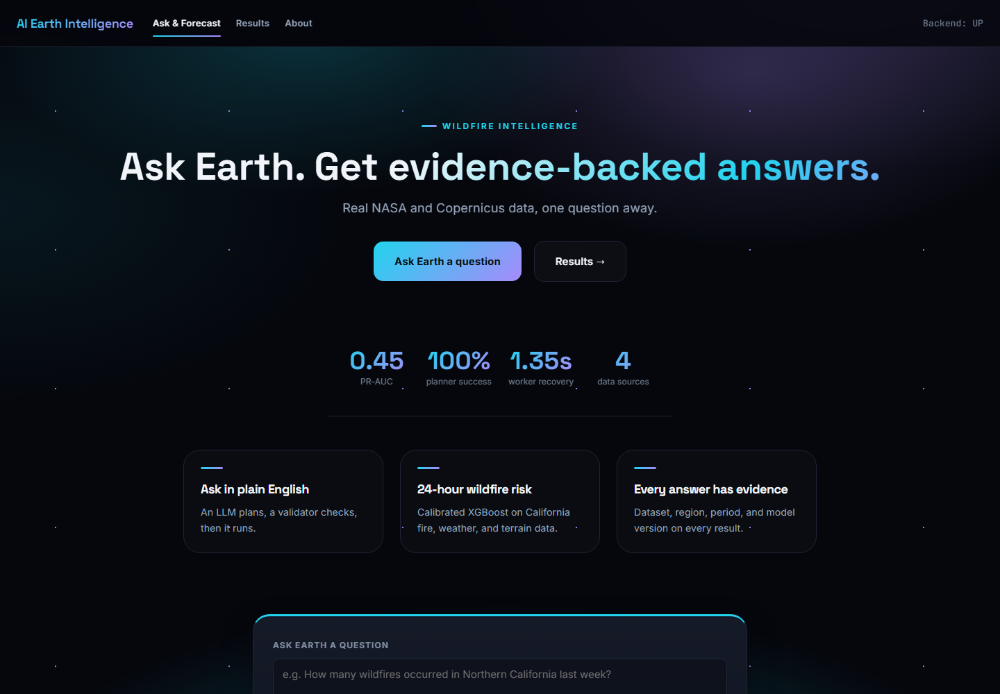
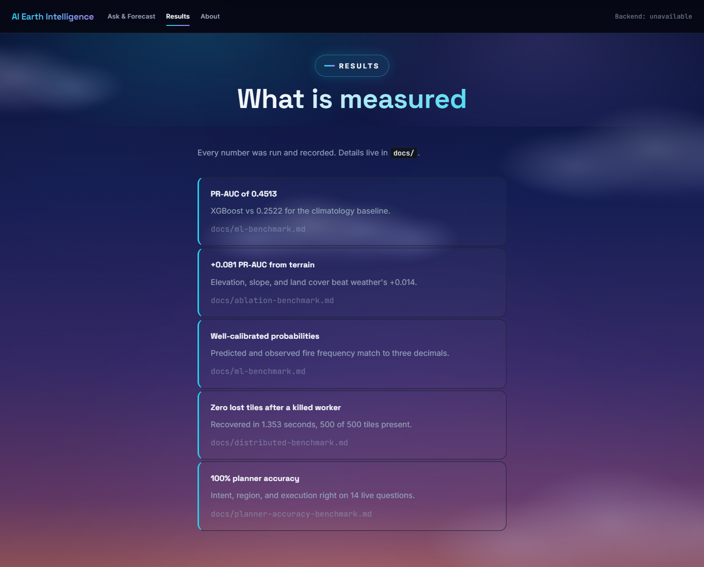
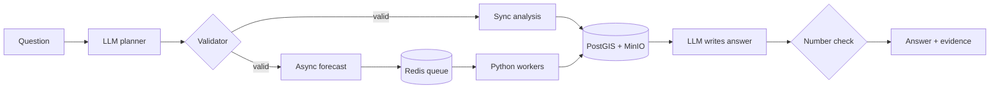

<div align="center">

# AI Earth Intelligence & Forecasting Engine

**Ask Earth a question in plain English. Get an answer backed by real data, a trained model, and the evidence behind every number.**

[](https://github.com/khoahonguyen0210/Earth_intelligence/actions/workflows/ci.yml)


[](LICENSE)



</div>

```text
"How many wildfires occurred in the Bay Area during August 2024?"
"What's the wildfire risk for California starting tomorrow?"
```

## Results

<div align="center">



</div>

PR-AUC on the held-out 2024 test year, with 95% intervals from a bootstrap over forecast dates.

| Measure | Result |
|---|---|
| XGBoost | **0.451** (0.374 to 0.521) |
| Served model, calibrated XGBoost | **0.436** (0.360 to 0.503) |
| Gain over climatology (0.252) | **+0.199** (0.125 to 0.265) |
| Gain over "fires in the last 24 hours" (0.384) | **+0.068** (0.031 to 0.101) |
| Regions never seen in training | **0.346**, down 0.105 |
| Terrain and land cover | **+0.081** PR-AUC over fire history and weather alone |
| Worker killed mid-run | **0 tiles lost**, recovered in **1.35 s** |
| Planner on 14 live questions | **100%** intent, region, and execution |

The model clearly beats climatology, but a no-model rule that predicts fire where it burned yesterday already gets most of the way. Intervals, the spatial holdout and drift checks are in [`docs/evaluation.md`](docs/evaluation.md). Mixed and negative findings are in [`docs/headline-results.md`](docs/headline-results.md).

## How it works



## Explainable answers

- **Every forecast explains itself.** Each grid cell lists the three inputs that moved its score most, using exact tree SHAP values from XGBoost. The forecast page shows the main drivers for the region.
- **The LLM sees real forecast numbers.** A planner tool passes the riskiest cells, peak and mean probability, and their drivers to the answer step.
- **Every number in an answer is checked.** After the LLM writes its answer, a deterministic check confirms each number appears in the computed results. Answers that fail are shown with a warning.

On the 2024 test year, recent fire history decides where fires actually happened, terrain sets the baseline elsewhere, and weather contributes least. Details are in [`docs/explainability.md`](docs/explainability.md).


## Tech stack

| Area | Tools |
|---|---|
| Languages | Python, Java, TypeScript, HCL (Terraform), CSS |
| Backend | Java 21, Spring Boot, JPA, Flyway, Maven |
| Frontend | React, TypeScript, Vite, Vitest |
| ML | Python 3.12, XGBoost, scikit-learn, xarray, Gemini |
| Data | PostGIS, Redis, MinIO / S3, NASA FIRMS, ERA5-Land, ESA WorldCover |
| Infra | Docker Compose, Kubernetes, Helm, KEDA, Terraform, AWS |
| Observability | Prometheus, OpenTelemetry, Jaeger |
| CI and quality | GitHub Actions, Trivy, Ruff, mypy, pytest |

## Quick start

You need Docker with Compose v2, plus a [NASA FIRMS key](https://firms.modaps.eosdis.nasa.gov/api/map_key/) and a [Gemini API key](https://aistudio.google.com/apikey).

```bash
cp .env.example .env          # add FIRMS_MAP_KEY and GEMINI_API_KEY
cd infra/docker
docker compose up -d --build
curl http://localhost:8080/readyz
```

| Service | URL |
|---|---|
| Frontend | http://localhost:5173 |
| Backend API | http://localhost:8080 |
| Jaeger | http://localhost:16686 |
| MinIO console | http://localhost:9001 |

Stop everything with `docker compose down -v`.

## Local development

Start the infrastructure, then run the backend and frontend on your machine. This needs JDK 21 and Node.js.

```bash
cd infra/docker && docker compose up -d postgres redis minio

cd backend && ./mvnw spring-boot:run     # terminal 1
cd frontend && npm ci && npm run dev     # terminal 2
```

The ML code needs Python 3.12 and [uv](https://docs.astral.sh/uv/). ERA5-Land downloads also need a Copernicus `CDSAPI_KEY`.

## Testing

```bash
cd infra/docker && docker compose up -d postgres redis minio   # backend tests need these
cd backend && ./mvnw test
uv run --project ml pytest ml/tests -q
cd frontend && npm test
```

There are over 700 tests, and the backend ones run against real Postgres, Redis, and MinIO. CI runs Python, Java, frontend, and a Trivy dependency and secret scan on every push.

## API

| Method | Endpoint | Purpose |
|---|---|---|
| POST | `/queries` | Ask a natural-language question |
| GET | `/queries/{id}/result` | Answer and evidence |
| POST | `/analyses` | Fire-history analysis for a region and period |
| POST | `/forecasts` | Submit a 24-hour risk forecast |
| GET | `/forecasts/{id}` | Job status |
| GET | `/forecasts/{id}/result` | Forecast result |
| GET | `/readyz` | Backend, database, and Redis health |

Bodies use snake_case. Full contracts: [`forecast-api-contract.md`](docs/forecast-api-contract.md) and [`ask-earth.md`](docs/ask-earth.md).

## Configuration

Keys go in `.env` (git-ignored). Everything else has a default in `application.properties` that an environment variable can override.

| Variable | Purpose |
|---|---|
| `GEMINI_API_KEY` | Natural-language planner |
| `FIRMS_MAP_KEY` | NASA FIRMS fire detections |
| `CDSAPI_URL`, `CDSAPI_KEY` | ERA5-Land weather |
| `SPRING_DATASOURCE_URL` | Database, default `localhost:5432/ai_earth` |
| `REDIS_HOST`, `REDIS_PORT` | Redis, default `127.0.0.1:6379` |
| `OBJECT_STORE_ENDPOINT`, `OBJECT_STORE_BUCKET` | MinIO or S3 |
| `LOG_FORMAT` | `ecs` (JSON) by default |

## Repository layout

```text
backend/    Spring Boot API, JPA, Flyway migrations
frontend/   React + Vite app
ml/         Data, features, models, planner, distributed runs
scripts/    Data download, benchmark, and demo scripts
infra/      Docker, Kubernetes, kind, Terraform
.github/    CI workflow
docs/       Contracts, architecture, benchmarks, portfolio evidence
```

## Deployment

`infra/docker` runs the full stack locally. `infra/k8s` and `infra/kind` run it on Kubernetes. `infra/terraform` defines the AWS target (VPC, EKS, RDS, ElastiCache, ECR, S3, Secrets Manager). It passes `fmt` and `validate`, and Trivy reports one accepted finding. The load balancer is created by the AWS Load Balancer Controller from the Ingress. Nothing has been applied to a live AWS account, since the environment costs about $0.40 per hour. See [`cloud-deployment.md`](docs/cloud-deployment.md).

## Security

The API has no user authentication yet, so keep it off the public internet. Requests are size-limited and rate-limited, secrets are redacted from logs, and the default passwords in the Compose files are for local use only.

## License

MIT. See [`LICENSE`](LICENSE). Built by [Khoa Ho Nguyen](https://github.com/khoahonguyen0210).
