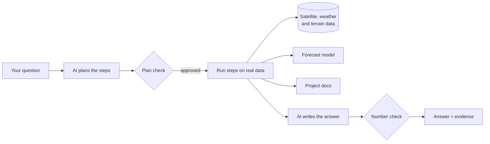

<div align="center">

# AI Earth Intelligence & Forecasting Engine

**Ask questions about the Earth in plain English. Get answers backed by real satellite and weather data, a trained forecasting model, and the evidence behind every number.**

[](https://github.com/khoahonguyen0210/Earth_intelligence/actions/workflows/ci.yml)


[](LICENSE)


</div>

```text
"How many wildfires occurred in the Bay Area during August 2024?"
"What's the wildfire risk for California starting tomorrow?"
"Does the model beat a simple baseline?"
```

## Overview

Earth data is public, but it is hard to use. Answering a simple question such as "how many fires burned near San Francisco last summer?" means downloading satellite files, cleaning them, matching them to a map, and doing the math yourself.

AI Earth Intelligence does that work for you. You type a question, an AI model works out which steps are needed, and the system runs those steps on real data. It can count and map past events, forecast wildfire risk for the next 24 hours, and explain how it works. Every answer comes with the data behind it, and every number in the answer is checked against the real results, so the AI cannot make one up.

The system currently covers California, using NASA satellite fire detections, ERA5-Land weather, and terrain and land cover data.

## Key Features

- **Ask in plain English** — Type a question and get a written answer with maps, tables, and sources.
- **Safe AI planning** — The AI can only choose from eight fixed actions, such as "find a region", "count events", or "run a forecast", and every plan is checked before anything runs.
- **Answers you can verify** — Every number in an answer is checked against the computed results, and every cited document must have actually been retrieved.
- **Wildfire risk forecasts** — A trained model predicts the chance of fire in each grid cell, about 10 km wide, for the next 24 hours.
- **Explained predictions** — Each grid cell shows the three factors that raised or lowered its risk the most.
- **Self-updating model** — When a new fire season ends, the system trains a new model and only switches to it if it is clearly better.
- **Reliable background jobs** — Forecasts run in the background with retries, duplicate protection, and recovery when a worker crashes.
- **Cloud-ready** — Jobs can run on Apache Kafka with a Go worker, job status can live in Amazon DynamoDB, and data and models can live in Amazon S3.
- **Built-in monitoring** — Metrics, request tracing, and structured logs for every request and job.

## How It Works



1. **You ask a question.** For example, "What's the wildfire risk for California starting tomorrow?"
2. **The AI makes a plan.** It picks steps from a short list of allowed actions, such as finding the region and running a forecast.
3. **The plan is checked.** Plans with unknown actions or missing inputs are rejected, and off-topic or harmful requests are refused.
4. **The steps run on real data.** The numbers come from real calculations, never from the AI.
5. **The AI writes the answer.** A final check confirms that every number in it matches the results. Answers that fail are shown with a warning.

Forecasts can also be requested directly through the API. These run as background jobs: the request is saved and queued, a worker picks it up and runs the model, and you check back for the result.

## Results

<div align="center">


</div>

The forecast model is scored on how well it ranks the places that actually burned (PR-AUC, higher is better). It was tested on 2024, a year held back from training, and on the 2025 season, which it had never seen. The ranges are 95% confidence intervals.

| Measure | 2024 test year | 2025 season |
|---|---|---|
| Our model (XGBoost) | **0.436** (0.360 to 0.503) | **0.464** (0.386 to 0.539) |
| Improvement over each cell's historical fire rate | +0.184 (0.113 to 0.248) | +0.143 (0.073 to 0.222) |
| Improvement over "where fires were seen in the last 24 hours" | +0.052 (0.017 to 0.086) | **+0.069** (0.037 to 0.104) |

| Other results | Value |
|---|---|
| Regions the model never trained on (2024) | **0.346**, 0.105 lower |
| A PyTorch neural network with the same inputs (2024) | **0.388**, 0.064 below XGBoost |
| Retraining on the 2025 season | New model **0.399** against **0.464**, so the current model was kept |
| Adding terrain and land cover | **+0.081** over fire history and weather alone |
| A worker killed mid-run | **0 grid cells lost**, recovered in **1.35 s** |
| AI planner on 22 real questions | **100%** correct intent and region, **6 of 6** off-topic or malicious requests blocked |

More detail is in [`docs/evaluation.md`](docs/evaluation.md), [`docs/neural-baseline.md`](docs/neural-baseline.md), and [`docs/retraining.md`](docs/retraining.md). Mixed and negative results are in [`docs/headline-results.md`](docs/headline-results.md).

## Technology Stack

| Component | Technology | Purpose |
|---|---|---|
| Backend API | Java 21, Spring Boot | Receives questions and jobs, stores results |
| AI | Gemini | Plans the steps, writes answers, searches the docs |
| Data and models | Python, XGBoost, scikit-learn, xarray, PyTorch | Loads Earth data, computes results, forecasts risk |
| Frontend | React, TypeScript, Vite | Ask questions and explore maps |
| Job worker | Go | Processes forecast jobs from Kafka |
| Message queues | Redis, Apache Kafka | Pass forecast jobs to workers |
| Databases | PostgreSQL + PostGIS, Amazon DynamoDB | Store results, questions, and job status |
| Object storage | Amazon S3, MinIO | Datasets, model versions, and large results |
| Monitoring | Prometheus, OpenTelemetry, Jaeger | Metrics and request traces |
| Infrastructure | Docker Compose, Kubernetes, Helm, KEDA, Terraform | Run locally, on Kubernetes, and on AWS |
| Quality | GitHub Actions, JUnit, pytest, Vitest, go test, Ruff, mypy, Trivy | Tests, linting, and security scans on every push |

## Data

| Source | What it provides |
|---|---|
| [NASA FIRMS](https://firms.modaps.eosdis.nasa.gov/) | Fires detected by satellites |
| [ERA5-Land](https://cds.climate.copernicus.eu/) | Hourly temperature, rainfall, wind, and humidity |
| Copernicus DEM and ESA WorldCover | Elevation, slope, and land cover |

California is split into a grid of 0.1° cells, about 10 km wide. A forecast request names a region and a start time:

```json
{
  "region": { "kind": "named", "value": "california" },
  "cutoff": "2024-08-15T10:00:00Z"
}
```

Each cell in the result has a fire probability and the factors that drove it (example values):

```json
{
  "tile_id": "CA_0421_0583",
  "probability": 0.0374,
  "top_drivers": [
    { "feature": "previous_24h_count", "contribution": 1.21 },
    { "feature": "relative_humidity", "contribution": -0.43 },
    { "feature": "elevation_m", "contribution": 0.18 }
  ]
}
```

### Where data is stored

| Store | What it holds |
|---|---|
| PostgreSQL + PostGIS | Analyses, questions and answers, and forecast jobs (by default) |
| Amazon DynamoDB | Forecast job status, when `FORECAST_STORE=dynamodb` |
| Redis | The forecast job queue (by default) and rate limits |
| Apache Kafka | The forecast job queue, when `FORECAST_QUEUE=kafka` |
| Amazon S3 / MinIO | Training datasets, every model version, and large forecast results |

## Reliability

Forecast jobs are built to survive crashes and duplicates:

- **No duplicate jobs** — Sending the same request twice with the same `Idempotency-Key` returns the same job.
- **One worker per job** — A worker must claim a job before running it, so two workers never run the same job.
- **Automatic retries** — Temporary failures are retried, and jobs left behind by a crashed worker are picked up again.
- **Bad messages are set aside** — Kafka messages that cannot be processed go to a dead-letter topic instead of blocking the queue.
- **Verified storage** — Every file sent to or read from S3 is checked with a SHA-256 checksum.

Each part of the job pipeline has a local default and an AWS option, chosen with one setting:

| Part | Default | AWS option | Details |
|---|---|---|---|
| Job queue and worker | Redis, Java worker | Kafka, Go worker | [`kafka-go-worker.md`](docs/kafka-go-worker.md) |
| Job status | PostgreSQL | DynamoDB | [`dynamodb-job-store.md`](docs/dynamodb-job-store.md) |
| Datasets and models | Local files | Amazon S3 | [`s3-artifacts.md`](docs/s3-artifacts.md) |

## Keeping the Model Up to Date

When a fire season ends, one command downloads the new data, trains a new model on all earlier seasons, and compares it with the current model on the new season. The new model is only used if it is clearly better, and every decision is logged and can be rolled back.

```bash
uv run --project ml python scripts/models/auto_retrain.py
```

Seasons that were already processed are skipped, so the command is safe to run on a schedule. On the 2025 season, the new model scored 0.399 against 0.464, so the current model was kept. See [`docs/retraining.md`](docs/retraining.md).

## Getting Started

### Prerequisites

- Docker with Docker Compose v2
- [uv](https://docs.astral.sh/uv/) for the Python scripts
- A free [NASA FIRMS key](https://firms.modaps.eosdis.nasa.gov/api/map_key/), a [Gemini API key](https://aistudio.google.com/apikey), and a Copernicus CDS key for weather data

### 1. Clone the repository

```bash
git clone https://github.com/khoahonguyen0210/Earth_intelligence.git
cd Earth_intelligence
```

### 2. Add your keys

```bash
cp .env.example .env    # then fill in FIRMS_MAP_KEY, GEMINI_API_KEY, CDSAPI_URL and CDSAPI_KEY
```

### 3. Build the data and the model

The data and the trained model are not stored in the repository, so build them once:

```bash
uv run --project ml python scripts/data/download_firms_history.py
uv run --project ml python scripts/data/download_era5_history.py
uv run --project ml python scripts/data/build_statewide_geography.py
uv run --project ml python scripts/forecast/build_historical_dataset.py
uv run --project ml python scripts/models/train_production_model.py
uv run --project ml python scripts/rag/build_docs_index.py
```

The weather download takes a while because requests wait in a queue on the Copernicus servers. If it stops, run it again and it continues where it left off. If the data and model are already in an S3 bucket, run `scripts/storage/s3_artifacts.py pull-datasets` and `pull-model --serve` instead.

### 4. Start the system

```bash
cd infra/docker
docker compose up -d --build
curl http://localhost:8080/readyz
```

| Service | URL |
|---|---|
| Web app | http://localhost:5173 |
| Backend API | http://localhost:8080 |
| Jaeger (traces) | http://localhost:16686 |
| MinIO console | http://localhost:9001 |

To use Kafka, the Go worker, and DynamoDB instead of the defaults:

```bash
FORECAST_QUEUE=kafka FORECAST_STORE=dynamodb docker compose --profile kafka up -d --build
```

### 5. Try it

Open http://localhost:5173 and ask a question, or send a forecast job to the API:

```bash
curl -X POST http://localhost:8080/forecasts -H "Content-Type: application/json" \
  -d '{"region": {"kind": "named", "value": "california"}, "cutoff": "2024-08-15T10:00:00Z"}'
curl http://localhost:8080/forecasts/<forecast_id>          # job status
curl http://localhost:8080/forecasts/<forecast_id>/result   # the forecast
```

Stop everything with `docker compose down -v`.

## Local Development

Start the databases and queues, then run the backend and frontend on your machine. This needs JDK 21 and Node.js, plus Go 1.25 if you work on the worker.

```bash
cd infra/docker && docker compose up -d postgres redis minio

cd backend && ./mvnw spring-boot:run     # terminal 1
cd frontend && npm ci && npm run dev     # terminal 2
```

The Python code needs Python 3.12 and uv. The PyTorch comparison needs `uv sync --group research` first.

## Testing

```bash
cd infra/docker && docker compose --profile kafka up -d postgres redis minio dynamodb kafka
cd backend && ./mvnw test
uv run --project ml pytest ml/tests -q
cd frontend && npm test
cd worker && go test -race ./...
```

There are more than 950 tests. The backend tests run against real PostgreSQL, Redis, MinIO, DynamoDB Local, and Kafka. CI runs every test suite and a Trivy security scan on each push.

## API

| Method | Endpoint | Purpose |
|---|---|---|
| POST | `/queries` | Ask a question in plain English |
| GET | `/queries/{id}/result` | Get the answer and its evidence |
| POST | `/analyses` | Analyze fire history for a region and time period |
| POST | `/forecasts` | Start a 24-hour risk forecast |
| GET | `/forecasts/{id}` | Check a forecast job's status |
| GET | `/forecasts/{id}/result` | Get the forecast |
| GET | `/livez`, `/readyz` | Health checks |

Request and response bodies use snake_case. Full details are in [`forecast-api-contract.md`](docs/forecast-api-contract.md) and [`ask-earth.md`](docs/ask-earth.md).

## Configuration

API keys go in `.env`, which Git ignores. Every other setting has a default in `application.properties` and can be changed with an environment variable.

| Variable | Purpose |
|---|---|
| `GEMINI_API_KEY` | AI planning, answers, and document search |
| `FIRMS_MAP_KEY` | NASA FIRMS fire detections |
| `CDSAPI_URL`, `CDSAPI_KEY` | ERA5-Land weather |
| `SPRING_DATASOURCE_URL` | Database, default `localhost:5432/ai_earth` |
| `REDIS_HOST`, `REDIS_PORT` | Redis, default `127.0.0.1:6379` |
| `OBJECT_STORE_ENDPOINT`, `OBJECT_STORE_BUCKET` | MinIO or S3 for results |
| `ARTIFACT_BUCKET`, `S3_ENDPOINT_URL`, `AWS_REGION` | S3 bucket for datasets and models |
| `FORECAST_QUEUE`, `KAFKA_BOOTSTRAP_SERVERS` | Job queue: `redis` (default) or `kafka` |
| `FORECAST_STORE`, `FORECAST_JOBS_TABLE`, `DYNAMODB_ENDPOINT` | Job status: `postgres` (default) or `dynamodb` |
| `LOG_FORMAT` | Log format, `ecs` (JSON) by default |

## Project Structure

```text
backend/    Spring Boot API and database migrations
frontend/   React web app
ml/         Data loading, features, models, AI planner, document search, retraining
worker/     Go worker that runs forecast jobs from Kafka
scripts/    Data download, training, evaluation, S3, and demo scripts
infra/      Docker Compose, Kubernetes, and Terraform
docs/       API contracts, architecture, benchmarks, and design notes
```

## Deployment

`infra/docker` runs the whole system on one machine. `infra/k8s` and `infra/kind` run it on Kubernetes, with workers that scale with the queue length. `infra/terraform` describes the AWS setup: VPC, EKS, RDS, ElastiCache, DynamoDB, ECR, S3, and Secrets Manager. It passes `terraform validate` and a Trivy scan with one accepted finding. It has not been applied to a live AWS account, because the environment costs about $0.40 per hour. See [`cloud-deployment.md`](docs/cloud-deployment.md).

## Security

The API has no user login yet, so keep it off the public internet. Requests are limited in size and rate, secrets are removed from logs, and the passwords in the Compose files are for local use only. The AI can only use eight fixed actions, and every plan is checked before it runs.

## Author

This is a personal project, built end to end by one person. Issues and suggestions are welcome.

| Name | Role | GitHub |
|---|---|---|
| Khoa Ho Nguyen | Author and maintainer | [@khoahonguyen0210](https://github.com/khoahonguyen0210) |

## License

MIT. See [`LICENSE`](LICENSE).
