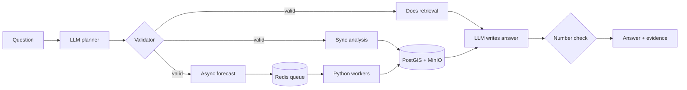

<div align="center">

# AI Earth Intelligence & Forecasting Engine

**Ask Earth a question in plain English. Get an answer backed by real data, a trained model, and the evidence behind every number.**

[](https://github.com/khoahonguyen0210/Earth_intelligence/actions/workflows/ci.yml)


[](LICENSE)


</div>

```text
"How many wildfires occurred in the Bay Area during August 2024?"
"What's the wildfire risk for California starting tomorrow?"
```

## Results

<div align="center">


</div>

PR-AUC with 95% intervals from a bootstrap over forecast dates, on the held-out 2024 test year and on the 2025 season, which the served model never saw.

| Measure | 2024 test year | 2025 season |
|---|---|---|
| Served model (calibrated XGBoost) | **0.436** (0.360 to 0.503) | **0.464** (0.386 to 0.539) |
| Gain over climatology | +0.184 (0.113 to 0.248) | +0.143 (0.073 to 0.222) |
| Gain over "fires in the last 24 hours" | +0.052 (0.017 to 0.086) | **+0.069** (0.037 to 0.104) |

| Other measures | Result |
|---|---|
| Regions never seen in training (2024) | **0.346**, down 0.105 |
| PyTorch neural network, same features (2024) | **0.388**, 0.064 below XGBoost |
| Retraining on the 2025 season | candidate **0.399** against **0.464**, so the current model stays |
| Terrain and land cover | **+0.081** PR-AUC over fire history and weather alone |
| Worker killed mid-run | **0 tiles lost**, recovered in **1.35 s** |
| Planner on 22 live questions | **100%** intent and region correct, **6 of 6** out-of-scope and attack questions contained |

Intervals, the spatial holdout, drift checks and the 2025 season are in [`docs/evaluation.md`](docs/evaluation.md), the network comparison in [`docs/neural-baseline.md`](docs/neural-baseline.md), and the retraining runs in [`docs/retraining.md`](docs/retraining.md). Mixed and negative findings are in [`docs/headline-results.md`](docs/headline-results.md).

## How it works



## Explainable answers

- **Every forecast explains itself.** Each grid cell lists the three inputs that moved its score most, using exact tree SHAP values from XGBoost. The forecast page shows the main drivers for the region.
- **The LLM sees real forecast numbers.** A planner tool passes the riskiest cells, peak and mean probability, and their drivers to the answer step.
- **Every number in an answer is checked.** After the LLM writes its answer, a deterministic check confirms each number appears in the computed results. Answers that fail are shown with a warning.

On the 2024 test year, recent fire history decides where fires actually happened, terrain sets the baseline elsewhere, and weather contributes least. Details are in [`docs/explainability.md`](docs/explainability.md).

## Learning from new data

When a fire season is complete, one command downloads its data, trains a candidate on all earlier seasons, and scores it, together with the model in service, on the new season that neither has seen. The candidate replaces the current model only if PR-AUC rises by at least 0.01 without worse calibration. Every candidate and decision is logged, and promotions can be rolled back. The 2024 test season can never decide a promotion.

```bash
uv run --project ml python scripts/models/auto_retrain.py
```

Seasons already processed are skipped, so the command is safe to run on a schedule, and the model then stays current with no manual steps. On the 2025 season the candidate scored 0.399 against 0.464 for the model in service, so the gate kept the current model. Details are in [`docs/retraining.md`](docs/retraining.md).

## Datasets and models on S3

The training datasets and every model version in the registry can live in Amazon S3, or in MinIO locally. Every upload is read back and checked against its SHA-256, every download is verified before it replaces a local file, and when a bucket is configured each retraining run uploads its candidate and the updated registry on its own.

```bash
uv run --project ml python scripts/storage/s3_artifacts.py push-datasets
uv run --project ml python scripts/storage/s3_artifacts.py pull-model --serve
```

The bucket is versioned and encrypted in Terraform. Commands, key layout and error handling are in [`docs/s3-artifacts.md`](docs/s3-artifacts.md).

## Forecast jobs in DynamoDB

Job status and metadata can live in DynamoDB instead of Postgres by setting `FORECAST_STORE=dynamodb`. Jobs are looked up by ID with a strongly consistent read, idempotency keys are kept unique with a conditional transaction, workers claim jobs with conditional updates, and the recovery sweep queries a `status`/`updated_at` index. Results too large for an item go to S3. Both stores pass the same contract tests, and DynamoDB Local runs in Compose. Details are in [`docs/dynamodb-job-store.md`](docs/dynamodb-job-store.md).

## Kafka and a Go worker

With `FORECAST_QUEUE=kafka`, the backend publishes each forecast job to a Kafka topic, and a worker written in Go consumes it and runs the job through one internal endpoint on the backend's management port, which claims it and calls the existing Python pipeline. Offsets are committed only after the backend answers, so delivery is at least once, and the backend's conditional claim makes duplicate deliveries harmless. Backend outages are retried with backoff, and malformed or rejected messages go to a dead-letter topic instead of blocking a partition.

```bash
cd infra/docker && FORECAST_QUEUE=kafka docker compose --profile kafka up -d --build
```

The message contract, delivery guarantees and tests are in [`docs/kafka-go-worker.md`](docs/kafka-go-worker.md).

## Questions about the system itself

Ask Earth can also answer questions about how it works, such as "Does the model beat a simple baseline?" or "Is there a login?". A planner tool retrieves passages from `docs/` using Gemini embeddings, and the answer cites each source by path. The answer check also fails any citation that was not actually retrieved.

On 35 labelled questions worded unlike the docs, embedding search finds a correct doc in the top 5 for 34 of them, against 24 for keyword search. Combining both did worse than embeddings alone, so the tool uses embeddings. Details are in [`docs/rag.md`](docs/rag.md).


## Tech stack

| Area | Tools |
|---|---|
| Languages | Python, Java, Go, TypeScript, HCL (Terraform), CSS |
| Backend | Java 21, Spring Boot, JPA, Flyway, Maven; Go worker with kafka-go |
| Frontend | React, TypeScript, Vite, Vitest |
| ML | Python 3.12, XGBoost (with its built-in tree SHAP), scikit-learn, NumPy, xarray, PyTorch (research baseline) |
| LLM and retrieval | Gemini (planning, answers, embeddings), BM25 |
| Data | PostGIS, DynamoDB, Redis, Kafka, MinIO / S3, NASA FIRMS, ERA5-Land, ESA WorldCover |
| Infra | Docker Compose, Kubernetes, Helm, KEDA, Terraform, AWS |
| Observability | Prometheus, OpenTelemetry, Jaeger |
| CI and quality | GitHub Actions, Trivy, Ruff, mypy, pytest, go vet, go test -race |

## Quick start

You need Docker with Compose v2, [uv](https://docs.astral.sh/uv/), and three keys: a [NASA FIRMS key](https://firms.modaps.eosdis.nasa.gov/api/map_key/), a [Gemini API key](https://aistudio.google.com/apikey), and a Copernicus CDS key for ERA5-Land weather.

The historical data, the trained model and the docs search index are build outputs, not stored in the repository, and the backend image copies them in. Build them once:

```bash
cp .env.example .env          # add FIRMS_MAP_KEY, GEMINI_API_KEY, CDSAPI_URL and CDSAPI_KEY
uv run --project ml python scripts/data/download_firms_history.py
uv run --project ml python scripts/data/download_era5_history.py
uv run --project ml python scripts/data/build_statewide_geography.py
uv run --project ml python scripts/forecast/build_historical_dataset.py
uv run --project ml python scripts/models/train_production_model.py
uv run --project ml python scripts/rag/build_docs_index.py
```

The downloads take a while, because ERA5-Land requests queue on the Copernicus servers. They resume if interrupted. If the data and model are already in a bucket, `s3_artifacts.py pull-datasets` and `pull-model --serve` replace these steps. Then start the stack:

```bash
cd infra/docker
docker compose up -d --build
curl http://localhost:8080/readyz
```

| Service | URL |
|---|---|
| Frontend | http://localhost:5173 |
| Backend API | http://localhost:8080 |
| Jaeger | http://localhost:16686 |
| MinIO console | http://localhost:9001 |

Stop everything with `docker compose down -v`.

## Local development

Start the infrastructure, then run the backend and frontend on your machine. This needs JDK 21 and Node.js.

```bash
cd infra/docker && docker compose up -d postgres redis minio dynamodb

cd backend && ./mvnw spring-boot:run     # terminal 1
cd frontend && npm ci && npm run dev     # terminal 2
```

The ML code needs Python 3.12 and [uv](https://docs.astral.sh/uv/), and the data and model from the quick start. The PyTorch comparison needs `uv sync --group research` first.

## Testing

```bash
cd infra/docker && docker compose --profile kafka up -d postgres redis minio dynamodb kafka   # backend tests need these
cd backend && ./mvnw test
uv run --project ml pytest ml/tests -q
cd frontend && npm test
cd worker && go test -race ./...
```

There are over 850 tests, and the backend ones run against real Postgres, Redis, MinIO, DynamoDB Local and Kafka. CI runs Python, Java, Go, frontend, and a Trivy dependency and secret scan on every push.

## API

| Method | Endpoint | Purpose |
|---|---|---|
| POST | `/queries` | Ask a natural-language question |
| GET | `/queries/{id}/result` | Answer and evidence |
| POST | `/analyses` | Fire-history analysis for a region and period |
| POST | `/forecasts` | Submit a 24-hour risk forecast |
| GET | `/forecasts/{id}` | Job status |
| GET | `/forecasts/{id}/result` | Forecast result |
| GET | `/readyz` | Backend, database, and Redis health |

Bodies use snake_case. Full contracts: [`forecast-api-contract.md`](docs/forecast-api-contract.md) and [`ask-earth.md`](docs/ask-earth.md).

## Configuration

Keys go in `.env` (git-ignored). Everything else has a default in `application.properties` that an environment variable can override.

| Variable | Purpose |
|---|---|
| `GEMINI_API_KEY` | Planner, answers and docs embeddings |
| `FIRMS_MAP_KEY` | NASA FIRMS fire detections |
| `CDSAPI_URL`, `CDSAPI_KEY` | ERA5-Land weather |
| `SPRING_DATASOURCE_URL` | Database, default `localhost:5432/ai_earth` |
| `REDIS_HOST`, `REDIS_PORT` | Redis, default `127.0.0.1:6379` |
| `OBJECT_STORE_ENDPOINT`, `OBJECT_STORE_BUCKET` | MinIO or S3 |
| `ARTIFACT_BUCKET`, `S3_ENDPOINT_URL`, `AWS_REGION` | S3 bucket for datasets and models |
| `FORECAST_STORE`, `FORECAST_JOBS_TABLE`, `DYNAMODB_ENDPOINT` | Job store: `postgres` (default) or `dynamodb` |
| `FORECAST_QUEUE`, `KAFKA_BOOTSTRAP_SERVERS` | Job queue: `redis` (default) or `kafka` |
| `LOG_FORMAT` | `ecs` (JSON) by default |

## Repository layout

```text
backend/    Spring Boot API, JPA, Flyway migrations
frontend/   React + Vite app
ml/         Data, features, models, planner, docs retrieval, retraining, distributed runs
worker/     Go worker that consumes forecast jobs from Kafka
scripts/    Data download, training, evaluation, retrieval, retraining, S3 and demo scripts
infra/      Docker, Kubernetes, kind, Terraform
.github/    CI workflow
docs/       Contracts, architecture, benchmarks, portfolio evidence
```

## Deployment

`infra/docker` runs the full stack locally. `infra/k8s` and `infra/kind` run it on Kubernetes. `infra/terraform` defines the AWS target (VPC, EKS, RDS, ElastiCache, DynamoDB, ECR, S3, Secrets Manager). It passes `fmt` and `validate`, and Trivy reports one accepted finding. The load balancer is created by the AWS Load Balancer Controller from the Ingress. Nothing has been applied to a live AWS account, since the environment costs about $0.40 per hour. See [`cloud-deployment.md`](docs/cloud-deployment.md).

## Security

The API has no user authentication yet, so keep it off the public internet. Requests are size-limited and rate-limited, secrets are redacted from logs, and the default passwords in the Compose files are for local use only. The language model can only call eight approved tools, and every plan is validated before any step runs.

## Author

This is a personal project, built end to end by one person. Issues and suggestions are welcome.

| Name | Role | Github |
|---|---|---|
| Khoa Ho Nguyen | Author and maintainer | [@khoahonguyen0210](https://github.com/khoahonguyen0210) |

## License

MIT. See [`LICENSE`](LICENSE).
