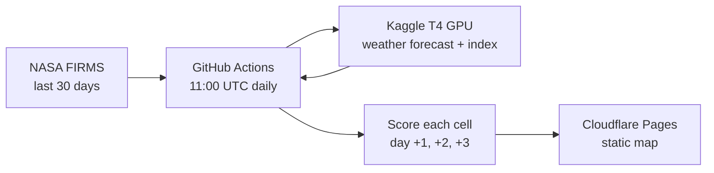

# Daily Risk Map

A public map of wildfire risk in California for the next three days,
updated once a day at no cost. It uses the models from the
[multi-day experiment](multi-day-risk.md).

The map is labeled as experimental. It shows its data cutoff and model
version, and links to the National Weather Service and CAL FIRE. It is
never presented as an official warning.

## How it works



1. **Choose the cutoff.** 10:00 UTC today. The weather forecast starts
   from the 06:00 UTC NOAA GFS analysis, the same timing the models were
   trained with.
2. **GPU run on Kaggle.** The workflow sends a small script to a private
   Kaggle notebook with a T4 GPU. It runs SFNO for three days, computes
   the index on the GPU, and saves the daily values over California.
   This step receives no secrets.
3. **Fire history.** Back on GitHub, the workflow downloads the last 30
   days of FIRMS detections with the FIRMS key and counts fires per cell.
4. **Score.** The three calibrated models give a risk for each cell and
   day. The models are stored as JSON (XGBoost trees and the calibration
   curve), not as Python pickles.
5. **Publish.** A static page with the map, `risk.json` and a log of
   recent runs goes to Cloudflare Pages. There is no server to keep
   running.

Water cells and cells without terrain data are not shown.

## Setup

Accounts (all free):

| Service | What to create |
|---|---|
| Kaggle | An account with a verified phone number (needed for GPUs), then an API token from **Settings → API** |
| NASA FIRMS | A map key from the FIRMS website |
| Cloudflare | A Pages project, an API token with **Cloudflare Pages: Edit**, and the account ID |

In the GitHub repository, under **Settings → Secrets and variables →
Actions**, add:

| Name | Kind | Value |
|---|---|---|
| `KAGGLE_USERNAME` | Secret | Kaggle user name |
| `KAGGLE_KEY` | Secret | Kaggle API key |
| `FIRMS_MAP_KEY` | Secret | FIRMS map key |
| `CLOUDFLARE_API_TOKEN` | Secret | Cloudflare API token |
| `CLOUDFLARE_ACCOUNT_ID` | Secret | Cloudflare account ID |
| `PAGES_PROJECT` | Variable | Pages project name |
| `PAGES_URL` | Variable | The site address, for example `https://name.pages.dev` |

Then copy the trained models into the repository:

```bash
python scripts/map/export_models.py
```

This writes `map/models/lead_1.json` to `lead_3.json` and
`metadata.json`. The workflow stops with a clear message until these
files exist.

To run it once by hand, open **Actions → Daily risk map → Run workflow**.

## Files

| File | Purpose |
|---|---|
| `.github/workflows/daily-risk-map.yml` | The daily schedule |
| `map/kernel/` | The script sent to Kaggle and the code that fills in its settings |
| `scripts/map/run_daily_forecast.py` | Runs on the GPU: forecast, index, stage times |
| `scripts/map/build_daily_map.py` | Runs on GitHub: fire history, scores, site files |
| `map/cells.csv` | Elevation, slope and land cover per cell (from `scripts/map/export_cells.py`) |
| `map/site/` | The static page |

## Pipeline profile

Every GPU run saves `summary.json` with the time of each stage, the peak
GPU memory and the total time. The workflow also prints this table in the
run summary.

| Stage | What it covers |
|---|---|
| `model_load` | Loading SFNO and the index code |
| `imports` | Importing Earth2Studio (part of `model_load`) |
| `model_weights` | Building SFNO, reading its weights and moving it to the GPU (part of `model_load`) |
| `data_source` | Opening the data source (part of `model_load`) |
| `data_loading` | Downloading the initial conditions |
| `host_to_device` | Copying them to the GPU |
| `model_forward` | All forecast steps |
| `index` | Building columns, the index on the full global grid, and the daily values over California |
| `index_kernel` | The index computation alone (part of `index`) |
| `writing_output` | Saving the result |

To profile a fixed past date, so that runs can be compared, run
`notebooks/daily_pipeline_on_t4.ipynb` on a Kaggle T4. It runs this
command once for each index version:

```bash
PYTHONPATH=ml/src python scripts/map/run_daily_forecast.py \
  --cutoff 2025-08-03T10:00:00+00:00 --source arco --profile
```

`--implementation` selects `eager`, `torch_compile`, `triton` or `cuda`
for the index. `--profile` adds a second run under `torch.profiler` and
saves its operator table to `profile_table.txt`. `--rows-per-chunk` and
`--channels-per-chunk` set the block sizes of the memory changes in
[Earth-2 Models on a T4](earth2-models-on-t4.md#fitting-sfno-on-a-t4)
(0 turns a change off).

### Profile results on a T4

Run with `notebooks/daily_pipeline_on_t4.ipynb`
(`ml/artifacts/daily_pipeline/`): cutoff 2025-08-03 10:00 UTC, ERA5 from
ARCO, SFNO for 11 steps of 6 hours, index version `hdwi_approx_v1`.
Tesla T4, PyTorch 2.11.0, Earth2Studio 0.20.0.

Stage times with eager PyTorch for the index:

| Stage | Seconds | Share of the run |
|---|---:|---:|
| `model_load` | 65.5 | 57.3% |
| `data_loading` | 10.5 | 9.2% |
| `host_to_device` | 0.10 | 0.1% |
| `model_forward` (11 steps) | 37.3 | 32.7% |
| `index` (9 forecast times) | 0.48 | 0.4% |
| `index_kernel` (part of `index`) | 0.30 | 0.3% |
| `writing_output` | 0.03 | under 0.1% |
| **Total** | **114.4** | |

Peak GPU memory was 12.76 GB.

Each index version ran in its own process, so each time below includes
its one-time setup:

| Index version | `index_kernel` (s) | Share of the run | Total (s) |
|---|---:|---:|---:|
| Eager PyTorch | 0.30 | 0.3% | 114.4 |
| Triton | 1.31 | 1.3% | 101.5 |
| `torch.compile` | 7.67 | 7.1% | 108.6 |
| CUDA C++ | 23.75 | 19.2% | 123.5 |

What this shows:

- **Loading the model takes more than half of the run**, and the
  forecast steps take about a third. The index takes 0.3%.
- **In one daily run, the compiled versions are slower than eager
  PyTorch.** Their first call includes compiling: the CUDA C++ extension
  is built with `nvcc` during the run. The
  [kernel benchmark](gpu-performance.md#benchmark) times only warm
  calls. There, the CUDA kernel saves about 15.6 ms per global field,
  which is about 0.14 s for the 9 forecast times of a run.
- **The fast kernels pay off only for larger workloads**, such as many
  forecasts or ensembles in one process. The daily run keeps eager
  PyTorch.
- **Runs with the same work differ.** Without `index_kernel`, the
  five totals range from 99.7 to 114.1 s, mostly because of
  `data_loading` (3.8 to 10.5 s) and `model_forward` (31.3 to 37.3 s).
  A small gain needs repeated runs to be seen.

The `torch.profiler` table of the eager run shows where the forecast
steps spend GPU time: 1 × 1 convolutions in cuDNN take 42% (11.1 of
26.5 s) and memory copies (`aten::copy_`) take 22% (5.7 s).

All five runs gave exactly the same daily features. The features are
always computed with the reference index, so this compares the
forecasts. One run used row blocks only, and the others also used
channel blocks, so running the spherical harmonic transforms in channel
blocks did not change any value of SFNO's output.

## Pipeline changes

Each change below was written down, with the stage it targets, that
stage's measured cost and a success criterion, before it was run. The
costs come from the profile runs above.

| # | Stage and measured cost | Change | Success criterion |
|---|---|---|---|
| 1 | `data_loading`: 3.8 to 10.5 s, which the run waits for after the model loads | Start downloading the initial conditions in a second thread before the model loads (`--overlap-loading`) | Total time at least 3 s lower; features identical |
| 2 | `model_forward`: 31.3 to 37.3 s; 1 × 1 convolutions take 42% of its GPU time | Let cuDNN time its algorithms and keep the fastest (`--cudnn-benchmark`) | `model_forward` at least 10% lower; features within the forecast tolerance |
| 3 | `model_forward`, as above | Run the forecast in float16 where PyTorch allows it, which uses the T4's tensor cores (`--half-precision`) | `model_forward` at least 20% lower; features within the forecast tolerance |
| 4 | `model_forward`, as above; peak memory 12.76 GB | Larger blocks: 128 rows and 64 channels, so fewer kernel launches | `model_forward` at least 5% lower; peak memory at most 14.0 GB; features identical |
| 5 | `host_to_device`: 0.09 to 0.10 s (0.1%) | Pinned host memory | Not run. The whole stage is under 0.1 s, too small to measure a gain. |
| 6 | `index_kernel`: 1.3 to 23.8 s for the compiled versions in one run, 0.3 s for eager PyTorch | Keep eager PyTorch for the index in the daily run | Decided from the profile runs. No new run. |

**Forecast tolerance.** Every value of every daily feature must be within
0.01 + 0.001 × |baseline value| of the float32 baseline, with missing
values in the same cells. This follows the precision rule: the forecast
stays in float32 unless a lower precision passes this check.

**Baseline.** The default settings run twice, to show how much two
identical runs differ. A change is kept only if it meets its criterion
against both baseline runs.

Run `notebooks/pipeline_changes_on_t4.ipynb` on a Kaggle T4, then compare
the runs:

```bash
python scripts/map/compare_daily_runs.py ml/artifacts/pipeline_changes
```

### Results of the changes

Run with `notebooks/pipeline_changes_on_t4.ipynb`
(`ml/artifacts/pipeline_changes/`, same cutoff and settings as the
profile runs). "Features" compares each run with baseline 1.

| Run | Total (s) | `model_load` | `data_loading` | `model_forward` | Peak memory (GB) | Features | Kept |
|---|---:|---:|---:|---:|---:|---|---|
| Baseline 1 | 108.6 | 61.9 | 4.6 | 41.0 | 12.76 | – | – |
| Baseline 2 | 97.4 | 62.7 | 2.0 | 31.8 | 12.76 | Identical | – |
| 1. Overlap loading | 94.6 | 63.5 | 0.0 | 30.3 | 12.76 | Identical | No |
| 2. cuDNN timing | 116.0 | 61.2 | 2.1 | 51.9 | 12.76 | Identical | No |
| 3. Float16 | 88.0 | 63.7 | 2.0 | 21.4 | 8.86 | Up to 1,827 × the limit | No |
| 4. Larger blocks | 98.1 | 61.4 | 2.0 | 33.8 | 12.76 | Identical | No |

- **Overlap loading** hid the download completely (`data_loading` fell
  to 0.0 s), but `model_load` grew by 0.7 to 1.6 s, because both threads
  share the CPU. The total fell by 14.1 s against baseline 1 and by
  2.9 s against baseline 2. It missed its 3 s criterion against
  baseline 2, so it was not kept.
- **cuDNN timing** made the forecast steps slower (51.9 s). Each block
  size is a new input shape, and timing the algorithms for each shape
  cost more than it saved in 11 steps.
- **Float16** made the forecast steps 33% to 48% faster and used 3.9 GB
  less memory, but it failed the forecast tolerance. The errors grow
  with lead time: the largest relative error of `hdw_max` was 0.6% on
  day +1, 0.8% on day +2 and 192% on day +3, and 47% of all `hdw_max`
  values were outside the limit. The forecast stays in float32.
- **Larger blocks** did not change the peak memory (12.76 GB), because
  the peak comes from other tensors. The forecast steps (33.8 s) fell
  between the two baselines.

None of the four changes met its criterion. The two identical baseline
runs differ by 9.2 s in `model_forward` (31.8 and 41.0 s), which is
larger than most of the gains tested.

The new sub-stages show where `model_load` goes: importing Earth2Studio
takes 43.5 to 45.2 s, about 40% of the whole run, and building SFNO and
moving it to the GPU takes 17.7 to 18.6 s.

## Cost

| Item | Cost |
|---|---|
| Kaggle GPU | Free, within the weekly GPU quota |
| GitHub Actions | Free for public repositories |
| Cloudflare Pages | Free plan |
| NASA FIRMS | Free |

## Sources and credits

Fire detections: NASA FIRMS (VIIRS). Weather forecast start: NOAA GFS.
Weather model: NVIDIA Earth2Studio (SFNO). Elevation: Copernicus DEM
GLO-30. Land cover: ESA WorldCover 2021, CC BY 4.0. Map tiles:
OpenStreetMap contributors.
