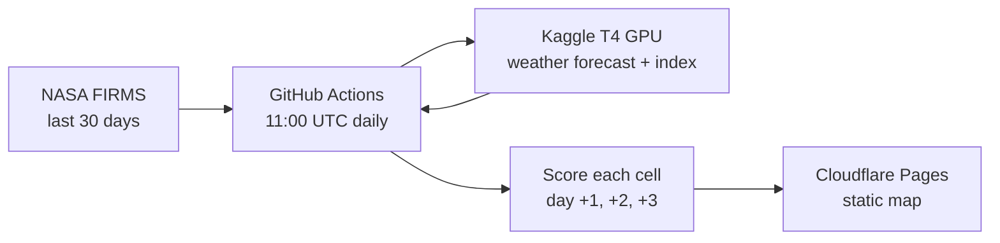

# Daily Risk Map

A public map of wildfire risk in California for the next three days,
updated once a day at no cost. It uses the models from the
[multi-day experiment](multi-day-risk.md).

The map is labeled as experimental. It shows its data cutoff and model
version, and links to the National Weather Service and CAL FIRE. It is
never presented as an official warning.

## How it works



1. **Choose the cutoff.** 10:00 UTC today. The weather forecast starts
   from the 06:00 UTC NOAA GFS analysis, the same timing the models were
   trained with.
2. **GPU run on Kaggle.** The workflow sends a small script to a private
   Kaggle notebook with a T4 GPU. It runs SFNO for three days, computes
   the index on the GPU, and saves the daily values over California.
   This step receives no secrets.
3. **Fire history.** Back on GitHub, the workflow downloads the last 30
   days of FIRMS detections with the FIRMS key and counts fires per cell.
4. **Score.** The three calibrated models give a risk for each cell and
   day. The models are stored as JSON (XGBoost trees and the calibration
   curve), not as Python pickles.
5. **Publish.** A static page with the map, `risk.json` and a log of
   recent runs goes to Cloudflare Pages. There is no server to keep
   running.

Water cells and cells without terrain data are not shown.

## Setup

Accounts (all free):

| Service | What to create |
|---|---|
| Kaggle | An account with a verified phone number (needed for GPUs), then an API token from **Settings → API** |
| NASA FIRMS | A map key from the FIRMS website |
| Cloudflare | A Pages project, an API token with **Cloudflare Pages: Edit**, and the account ID |

In the GitHub repository, under **Settings → Secrets and variables →
Actions**, add:

| Name | Kind | Value |
|---|---|---|
| `KAGGLE_USERNAME` | Secret | Kaggle user name |
| `KAGGLE_KEY` | Secret | Kaggle API key |
| `FIRMS_MAP_KEY` | Secret | FIRMS map key |
| `CLOUDFLARE_API_TOKEN` | Secret | Cloudflare API token |
| `CLOUDFLARE_ACCOUNT_ID` | Secret | Cloudflare account ID |
| `PAGES_PROJECT` | Variable | Pages project name |
| `PAGES_URL` | Variable | The site address, for example `https://name.pages.dev` |

Then copy the trained models into the repository:

```bash
python scripts/map/export_models.py
```

This writes `map/models/lead_1.json` to `lead_3.json` and
`metadata.json`. The workflow stops with a clear message until these
files exist.

To run it once by hand, open **Actions → Daily risk map → Run workflow**.

## Files

| File | Purpose |
|---|---|
| `.github/workflows/daily-risk-map.yml` | The daily schedule |
| `map/kernel/` | The script sent to Kaggle and the code that fills in its settings |
| `scripts/map/run_daily_forecast.py` | Runs on the GPU: forecast, index, stage times |
| `scripts/map/build_daily_map.py` | Runs on GitHub: fire history, scores, site files |
| `map/cells.csv` | Elevation, slope and land cover per cell (from `scripts/map/export_cells.py`) |
| `map/site/` | The static page |

## Pipeline profile

Every GPU run saves `summary.json` with the time of each stage, the peak
GPU memory and the total time. The workflow also prints this table in the
run summary.

| Stage | What it covers |
|---|---|
| `model_load` | Loading SFNO and the index code |
| `data_loading` | Downloading the initial conditions |
| `host_to_device` | Copying them to the GPU |
| `model_forward` | All forecast steps |
| `index` | Building columns, the index on the full global grid, and the daily values over California |
| `index_kernel` | The index computation alone (part of `index`) |
| `writing_output` | Saving the result |

To profile a fixed past date, so that runs can be compared, run on a
Kaggle T4:

```bash
PYTHONPATH=ml/src python scripts/map/run_daily_forecast.py \
  --cutoff 2025-08-03T10:00:00+00:00 --source arco --profile
```

`--implementation` selects `eager`, `torch_compile`, `triton` or `cuda`
for the index. `--profile` adds a second run under `torch.profiler` and
saves its operator table to `profile_table.txt`.

## Cost

| Item | Cost |
|---|---|
| Kaggle GPU | Free, within the weekly GPU quota |
| GitHub Actions | Free for public repositories |
| Cloudflare Pages | Free plan |
| NASA FIRMS | Free |

## Sources and credits

Fire detections: NASA FIRMS (VIIRS). Weather forecast start: NOAA GFS.
Weather model: NVIDIA Earth2Studio (SFNO). Elevation: Copernicus DEM
GLO-30. Land cover: ESA WorldCover 2021, CC BY 4.0. Map tiles:
OpenStreetMap contributors.
