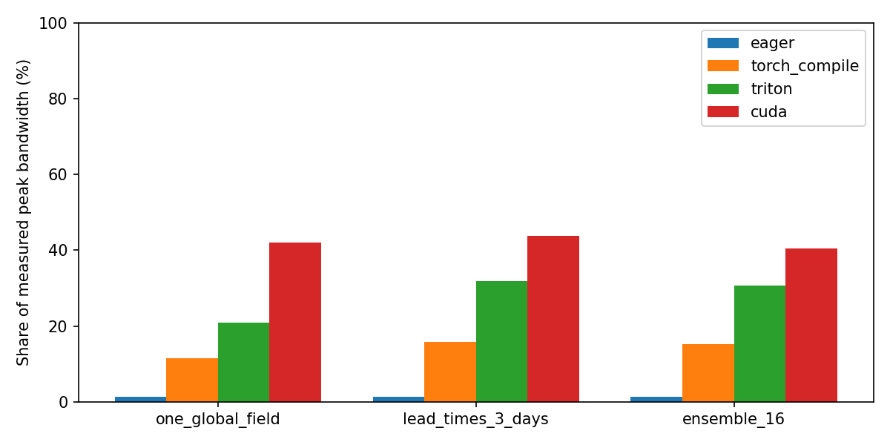

# GPU Performance

Faster versions of the [Hot-Dry-Windy Index](hot-dry-windy-index.md):
`torch.compile`, a Triton kernel and a CUDA C++ kernel, measured on an
NVIDIA T4.

## Why the index is a good kernel

The index reads nine fields for every grid column (five surface fields
and four fields on each pressure level), does a few operations per
value, and writes one number. Almost all the time goes into moving
data, not into math. A kernel like this is **memory-bound**: its speed
limit is the GPU's memory bandwidth.

Plain PyTorch runs the index as dozens of separate operations. Each one
reads its inputs from GPU memory and writes a full-size result back.
A fused kernel reads each input once, keeps running maxima in
registers, and writes one value per column.

## Correctness rules

These limits were set before any faster version was written. Every
version is compared with the float64 reference on random columns and on
every edge case.

| Check | Limit |
|---|---|
| Each value | \|error\| ≤ 0.001 + 0.0001 × \|reference value\| |
| Missing values | NaN in exactly the same columns as the reference |

The two tolerances work together, as in `torch.allclose`: the absolute
part covers values near zero, and the relative part covers large
values. A version that breaks a limit is marked as failed in the
results.

## Versions

| Version | File | How it works |
|---|---|---|
| Eager PyTorch | `kernels/hdwi_reference.py` | The reference itself, run in float32. |
| `torch.compile` | `kernels/hdwi_compiled.py` | The reference compiled with mode `max-autotune-no-cudagraphs`. PyTorch generates its own fused Triton kernels. |
| Triton | `kernels/hdwi_triton.py` | One program handles 256 columns and loops over the levels inside the kernel. |
| CUDA C++ | `kernels/hdwi_cuda.cu`, `hdwi_cuda.cpp`, `hdwi_cuda.py` | One thread per column, built with `torch.utils.cpp_extension.load`. Bounds are checked, and launch errors are raised as Python errors. |

The hand-written kernels follow the reference exactly:

- They use the same levels: every level above the ground, up to and
  including the first level more than 50 hPa above the surface. They
  stop reading at that level.
- They return NaN when any value the column uses is missing. Missing
  values below the ground or above the layer are ignored.
- They convert surface pressure from Pa to hPa by dividing by 100, not
  by multiplying by 0.01. Division is exact for whole numbers, so a
  surface that sits exactly on a pressure level picks the same levels as
  the float64 reference.

## Memory layout

Earth2Studio returns fields with longitude as the fastest-changing
dimension. `kernels/layout.py` keeps that order and only flattens the
grid:

```text
surface fields   (batch, columns)
level fields     (batch, levels, columns)
columns = latitude × longitude
```

Thread `i` handles column `i`, so at each level, neighboring threads
read neighboring addresses. The GPU can then combine the reads of a
whole warp into a few memory transactions (coalesced access). For
float32 inputs that are already contiguous, packing makes no copy.

## Tests

`tests/kernels/test_hdwi_gpu.py` runs all four versions against the
float64 reference:

- every edge case: calm wind, saturated air, missing values in used and
  unused levels, extreme values and high terrain;
- random columns on two level sets: the 13 levels of FourCastNet 3 and a
  dense set of 12 levels between 1000 and 700 hPa;
- surfaces that sit exactly on a level, or exactly 50 hPa below one.

The tests skip on a machine without a CUDA GPU.

## Benchmark method

`kernels/bench.py` and `scripts/research/run_gpu_benchmark.py`:

- **Sizes:** one global 0.25° field (721 × 1440 columns, 13 levels),
  12 fields (3 days of 6-hour steps) and 16 fields (an ensemble). A size
  that runs out of memory is recorded as such.
- **Timing:** CUDA events, 10 warmup runs, then 50 timed runs. The table
  reports the median and the 90th percentile.
- **Bytes moved:** the minimum the index needs: each surface field read
  once, each used level read once, and the output written once.
- **Effective bandwidth:** bytes moved divided by the median time.
- **Peak bandwidth:** measured on the same GPU by timing a 1 GiB
  device-to-device copy (bytes moved = 2 × size). Each version is
  reported as a share of this measured peak, not of the 320 GB/s on the
  datasheet.
- **Errors:** the maximum absolute and relative error against the
  float64 reference are saved for every run.

Run on a machine with a CUDA GPU:

```bash
cd ml
uv sync --group research
cd ..
python scripts/research/run_gpu_benchmark.py
```

Results go to `ml/artifacts/gpu_perf/<run_id>/`: `kernel_benchmark.csv`,
`summary.json` with the GPU, driver, CUDA, PyTorch and Triton versions,
and `percent_of_peak.png`.

Without a local GPU, run `notebooks/gpu_kernels_on_t4.ipynb` on a free
Kaggle T4 (see [notebooks/README.md](../notebooks/README.md)). It runs the
tests, the benchmark and, if the container allows it, Nsight Compute.

## Results on a T4

Run on a free Kaggle T4 with `notebooks/gpu_kernels_on_t4.ipynb`
(`ml/artifacts/gpu_perf/20261117T213631Z/`).

### Environment

| Item | Value |
|---|---|
| GPU | Tesla T4 (compute capability 7.5) |
| Driver | 580.178.04 |
| PyTorch | 2.11.0+cu130 (CUDA 13.0) |
| `nvcc` | CUDA 13.0, the same release as PyTorch's CUDA |
| Triton | 3.6.0; it compiles for compute capability 7.5 |
| Python | 3.13.16 |
| Nsight Compute | blocked: `ERR_NVGPUCTRPERM`, no access to hardware counters inside the Kaggle container |
| Measured peak bandwidth | 231.5 GB/s (datasheet: 320 GB/s) |

### Tests

All 31 GPU tests pass (`tests/kernels`, 57.9 s). Every version also
passes the edge cases inside the benchmark, and all 12 timed runs below
are within the tolerance.

### Benchmark

Each grid has 1,038,240 columns and 13 levels. Times are the median and
the 90th percentile of 50 runs. "Speedup" is against eager PyTorch at
the same size.

| Size | Version | Median (ms) | p90 (ms) | GB/s | % of peak | Speedup |
|---|---|---:|---:|---:|---:|---:|
| One global field | eager | 16.152 | 16.181 | 3.1 | 1.3 | 1.0× |
| | `torch.compile` | 1.905 | 1.932 | 26.5 | 11.4 | 8.5× |
| | Triton | 1.042 | 1.054 | 48.4 | 20.9 | 15.5× |
| | CUDA C++ | **0.517** | 0.529 | **97.5** | **42.1** | **31.2×** |
| 12 lead times | eager | 192.170 | 192.318 | 3.1 | 1.4 | 1.0× |
| | `torch.compile` | 16.694 | 16.814 | 36.2 | 15.7 | 11.5× |
| | Triton | 8.217 | 8.327 | 73.6 | 31.8 | 23.4× |
| | CUDA C++ | **5.974** | 5.992 | **101.3** | **43.7** | **32.2×** |
| 16 ensemble members | eager | 255.425 | 255.619 | 3.2 | 1.4 | 1.0× |
| | `torch.compile` | 22.962 | 23.175 | 35.1 | 15.2 | 11.1× |
| | Triton | 11.340 | 11.518 | 71.1 | 30.7 | 22.5× |
| | CUDA C++ | **8.612** | 8.723 | **93.7** | **40.5** | **29.7×** |



What this shows:

- **The CUDA kernel is the fastest at every size.** It reaches 40% to
  44% of the measured bandwidth and runs about 30 times faster than
  eager PyTorch.
- **Triton comes second** at 31% to 32% on the two larger sizes.
- **`torch.compile` helps, but less.** It is 8 to 12 times faster than
  eager, at 11% to 16% of peak. It fuses operations but still splits
  the work into several kernels.
- **Eager PyTorch is far from the limit** (about 1.4%), because each of
  its many small operations writes a full-size result back to memory.
  Its real memory traffic is much larger than the minimum bytes used
  here.
- **No version is close to the peak.** Nsight Compute could not read
  hardware counters on Kaggle, so the cause of the remaining gap was not
  measured.

An earlier run in the same session
(`ml/artifacts/gpu_perf/20261117T212220Z/`) gave nearly the same numbers
for the two larger sizes and for CUDA at every size. On the single
global field, Triton took 0.641 ms (33.8% of peak) and `torch.compile`
1.546 ms (14.0%) in that run, against 1.042 ms and 1.905 ms here. At
this small size, a run of about 1 ms is sensitive to the state of the
shared GPU, so the table reports the run in which the tests also ran.

## Kernel speed is not pipeline speed

The index is one small step after a weather model that runs for many
seconds. A faster index kernel only matters as much as the index's share
of the full run. Kernel results are always shown next to that share,
which comes from the stage times of the daily run (see
[Daily Risk Map](daily-risk-map.md#profile-results-on-a-t4)).

In one daily run on the same T4, the index computation with eager
PyTorch took 0.30 s of 114.4 s, or 0.3% of the run. It runs for 9
forecast times, so the CUDA kernel's saving of about 15.6 ms per global
field would save about 0.14 s, or about 0.1% of the run. In a new
process, the first call of each compiled version also includes its
compile time, so in the daily run each was slower than eager PyTorch:

| Version | Index time in one daily run (s) | Share of the run |
|---|---:|---:|
| Eager PyTorch | 0.30 | 0.3% |
| Triton | 1.31 | 1.3% |
| `torch.compile` | 7.67 | 7.1% |
| CUDA C++ (built during the run) | 23.75 | 19.2% |

The kernels pay off when one process computes the index many times,
for example for many forecasts or ensemble members.
